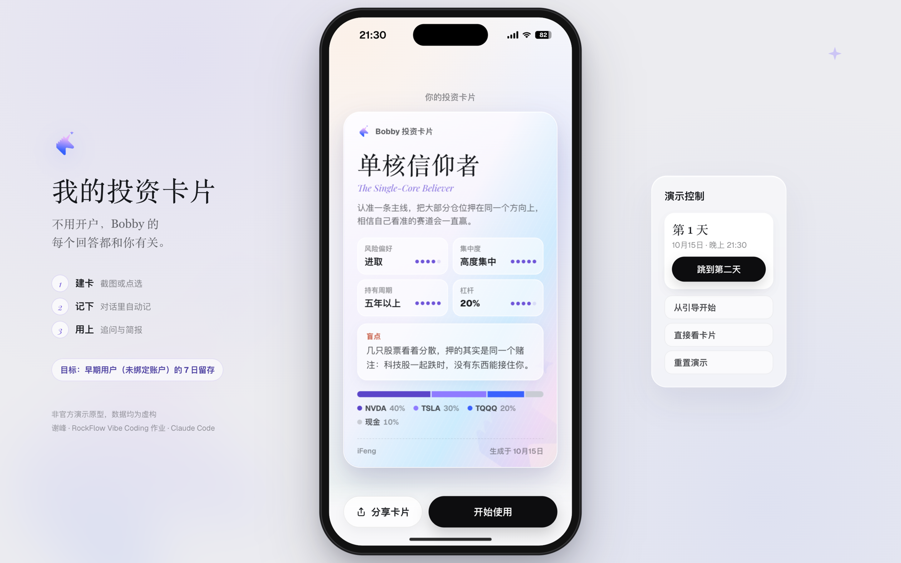
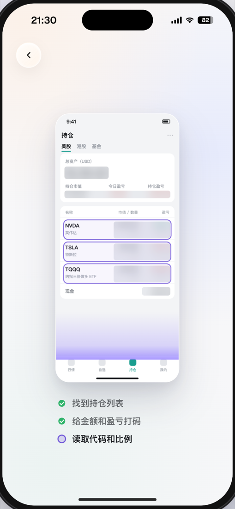
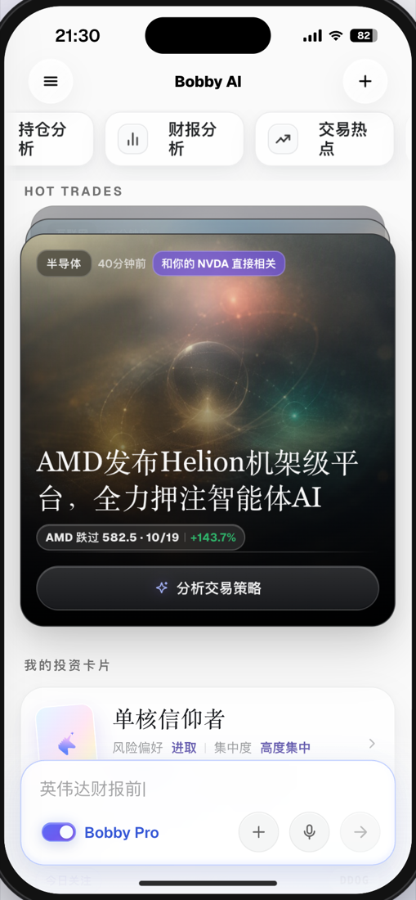
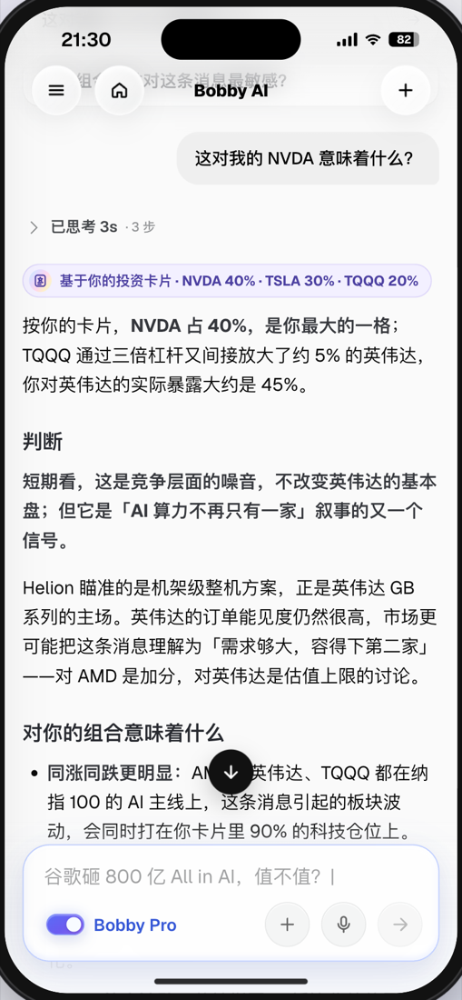
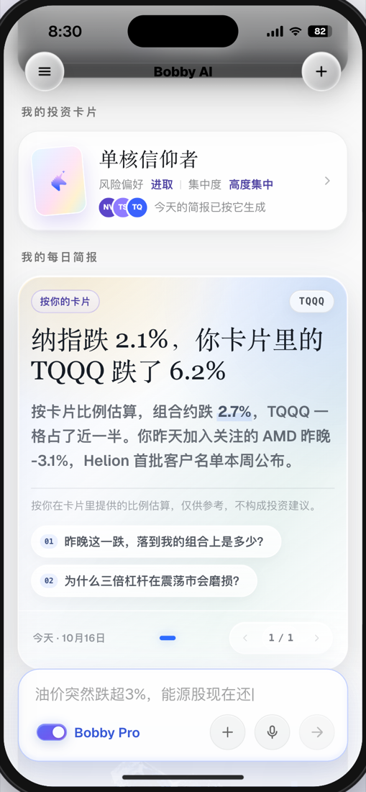

# 我的投资卡片

**不用开户，Bobby 的每个回答都和你有关**

为 AI 投资助手 Bobby 设计的新功能原型 · RockFlow Vibe Coding 作业

[**在线体验 →**](https://craboss888.github.io/bobby-investment-card/demo/)　·　[产品说明](交付/产品说明.md)　·　录屏另附

 

 

## 一句话

Bobby 的早期用户在开户之前，Bobby 对他一无所知、也不记得他：持仓分析只能给千篇一律的回答，每日简报是所有人都一样的大盘新闻，用户感受不到价值，很快就离开。

**投资卡片**是一张「投资版 MBTI」式的个人 profile。截一张任意券商的持仓图，或者点选几只关注的股票，再答两道行为题，Bobby 就有了一张看得见、可编辑的卡片。从这一刻起，首页、回答、追问和第二天的简报都围绕你展开。

> **目标指标**　早期用户（未绑定账户）的 7 日留存

 

## 它怎么工作

<table>
  <tr>
    <td width="25%" align="center"></td>
    <td width="25%" align="center"></td>
    <td width="25%" align="center"></td>
    <td width="25%" align="center"></td>
  </tr>
  <tr>
    <td valign="top"><b>建卡</b> 任意券商的持仓截图，只读代码和比例，金额自动打码、截图不保存</td>
    <td valign="top"><b>首页按你排序</b> 和你持仓有关的热点排到最前，标出「和你的 NVDA 直接相关」</td>
    <td valign="top"><b>回答按你展开</b> 先说和你有关的部分；追问按持仓生成，问到的新股票自动记进关注</td>
    <td valign="top"><b>第二天回来</b> 简报只讲你的股票：TQQQ 只占 20%，却贡献了近一半的跌幅</td>
  </tr>
</table>

卡片越用越完整，Bobby 越用越懂你。开户是最后一级台阶：想让持仓每天自动同步，再绑定 RockFlow 账户。

 

## 交付物

| | 内容 | 位置 |
|---|---|---|
| 1 | 一页产品说明：目标用户与场景、为什么是这个功能、核心交互、明确不做什么 | [交付/产品说明.md](交付/产品说明.md) |
| 2 | 可运行的原型 | [在线体验](https://craboss888.github.io/bobby-investment-card/demo/) · 代码在 [`demo/`](demo) · 录屏另附 |
| 3 | AI coding 过程记录：关键 prompt，以及 AI 做错、被纠正的地方 | [过程记录.md](过程记录.md) |
| 4 | 验证方案：看什么数据、找谁聊 | [交付/验证方案.md](交付/验证方案.md) |
| 5 | 风险说明：投资建议与合规边界 | [交付/风险说明.md](交付/风险说明.md) |

 

## 怎么体验

用电脑打开 [在线体验](https://craboss888.github.io/bobby-investment-card/demo/)，窗口宽一些（1180px 以上）能看到手机两侧的说明和「演示控制」；用手机打开则是全屏 App。

推荐路线，约 3 分钟：

1. 引导第 1 步选「新手入门」，第 2 步选「截图导入持仓」，点演示截图
2. 确认识别结果，答两道行为题，看卡片揭晓
3. 首页第一张热点（AMD）点「分析交易策略」，看回答顶部和底部
4. 点追问「这对我的 NVDA 意味着什么？」
5. 右侧「演示控制」点「跳到第二天」，看首页简报
6. 点首页「我的投资卡片」，进入卡片页

网址后缀　`#card` 直接带一张演示卡片　·　`#day2` 直接看第二天　·　本地运行：双击 `demo/index.html`

 

## 关于这个原型

- **非官方演示**：与 RockFlow 无关联，所有行情、持仓、新闻均为虚构，不接入真实账户与交易。
- **复刻 + 新功能**：Bobby 的首页、热点、对话等界面按 bobby.ai 网页版的样式数值与 App 录屏复刻；投资卡片是新增功能，主要代码在 [`profile.js`](demo/assets/js/profile.js) 与 [`profile.css`](demo/assets/css/profile.css)。
- **怎么做出来的**：主要用 Claude Code 完成。先实际体验 Bobby、选题，再写文档、做原型；原型经过两轮独立 AI 审查和一轮人工验收迭代，过程见 [过程记录](过程记录.md)。

 

谢峰 · 2026 年 10 月

